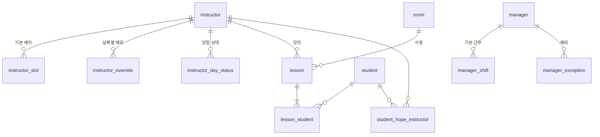

# 수강생 관리 사이트 DB 설계 (확정안)

기준: `수강생 관리 사이트 요구사항.md` / `수강생 관리 사이트 설계.md` (2026-10-28)
스택: Spring Boot + JPA(Hibernate) + H2 파일 모드 + Thymeleaf

---

## 1. 설계 원칙

- 테이블은 JPA 엔티티로 만들고 `ddl-auto=update`로 생성한다. 아래 DDL은 **참고용 기준**이다 (컬럼명·제약 확인용).
- 모든 테이블 PK는 `id BIGINT AUTO_INCREMENT` (조인 테이블 제외).
- 모든 엔티티는 `BaseEntity`를 상속: `created_at`, `updated_at` (`@CreatedDate`, `@LastModifiedDate` + `@EnableJpaAuditing`).
- enum은 전부 `@Enumerated(EnumType.STRING)`으로 저장 (순서 변경에 안전).
- 요일은 `java.time.DayOfWeek`를 STRING으로 저장 (`MONDAY` …).
- 교시는 `INT` 1~4.
- `date`, `no` 같은 이름은 H2 예약어 충돌 위험이 있어 쓰지 않는다 → `lesson_date`, `status_date` 등으로 명명.
- 근무 인원, 진행 중 수업, 빈 교실, 방문 회차 등 **계산 값은 저장하지 않는다** (조회 시 Java에서 계산).
- 동시성 검사(같은 강사·교실 중복 수업)는 DB 제약이 아니라 **서비스 계층에서 검증**한다. 같은 교시 안에서도 수업이 중간 종료 후 새로 시작될 수 있기 때문.
- 예약 동시 수정: 메모 예약은 화면에 보였던 글(`original`)과 DB 글을 비교해 그 사이 바뀌었으면 저장을 막는다(버전 컬럼 없음). 예약 쓰기 요청은 `ReservationController`의 `synchronized`로 하나씩 처리한다(미배정은 `instructor_id`가 NULL이라 UNIQUE가 막지 못함). 강사 시간표는 1분마다 자동으로 새로 불러온다(입력 중이면 미룸).

---

## 2. ERD



`check_item`은 다른 테이블과 관계 없음 (사람 이름은 텍스트로 기록).

---

## 3. Enum 정의

| Enum | 값 | 의미 |
| --- | --- | --- |
| `RoomType` | `NORMAL`, `COUNSEL`, `STORAGE` | 일반 / 상담실 / 창고 겸용 |
| `InstructorRole` | `MAIN`, `ASSIST` | 주 / 보조 (표시용) |
| `OverrideType` | `ABSENT`, `CONDITIONAL`, `EXTRA`, `NOTE` | 결근 / 조건부 / 추가 배치 / 메모 |
| `DayStatus` | `LEAVE_EARLY` | 조퇴 (`BREAK`·`OUT`은 10/29에 없앰) |
| `ManagerExceptionType` | `DAY_OFF`, `TIME_CHANGE` | 휴무 / 시간 변경 |

---

## 4. 테이블

### 4-1. 교실

```sql
CREATE TABLE room (
  id          BIGINT AUTO_INCREMENT PRIMARY KEY,
  name        VARCHAR(30)  NOT NULL UNIQUE,   -- 예: 1강의실, 상담실, 창고
  type        VARCHAR(20)  NOT NULL,          -- RoomType
  sort_order  INT          NOT NULL UNIQUE,   -- 자동 배정 순서 (작을수록 먼저)
  created_at  TIMESTAMP    NOT NULL,
  updated_at  TIMESTAMP    NOT NULL
);
```

초기 데이터 (`data.sql` 또는 `CommandLineRunner`, **테이블이 비어 있을 때만** 삽입):

| name | type | sort_order |
| --- | --- | --- |
| 1강의실 ~ 6강의실 | NORMAL | 1 ~ 6 |
| 상담실 | COUNSEL | 7 |
| 창고 | STORAGE | 8 |

> 교실 이름은 실제 센터 호칭으로 바꿔서 넣을 것.

### 4-2. 강사

```sql
CREATE TABLE instructor (
  id          BIGINT AUTO_INCREMENT PRIMARY KEY,
  name        VARCHAR(30)  NOT NULL,
  phone       VARCHAR(20),
  created_at  TIMESTAMP    NOT NULL,
  updated_at  TIMESTAMP    NOT NULL
);
CREATE INDEX idx_instructor_name ON instructor(name);

-- 요일·교시별 기본 배치
CREATE TABLE instructor_slot (
  id             BIGINT AUTO_INCREMENT PRIMARY KEY,
  instructor_id  BIGINT       NOT NULL REFERENCES instructor(id) ON DELETE CASCADE,
  day_of_week    VARCHAR(10)  NOT NULL,          -- DayOfWeek
  period         INT          NOT NULL CHECK (period BETWEEN 1 AND 4),
  role           VARCHAR(10)  NOT NULL,          -- InstructorRole
  note           VARCHAR(200),
  created_at     TIMESTAMP    NOT NULL,
  updated_at     TIMESTAMP    NOT NULL,
  CONSTRAINT uq_slot UNIQUE (instructor_id, day_of_week, period)
);

-- 날짜별 예외 (결근 / 조건부 / 추가 배치 / 메모)
CREATE TABLE instructor_override (
  id             BIGINT AUTO_INCREMENT PRIMARY KEY,
  instructor_id  BIGINT       NOT NULL REFERENCES instructor(id) ON DELETE CASCADE,
  type           VARCHAR(20)  NOT NULL,          -- OverrideType
  start_date     DATE         NOT NULL,
  end_date       DATE         NOT NULL,          -- 하루짜리는 start_date = end_date
  periods        VARCHAR(10),                    -- "1,3" / NULL = 전 교시
  role           VARCHAR(10),                    -- EXTRA일 때 주/보조 표시용 (선택)
  memo           VARCHAR(500),
  created_at     TIMESTAMP    NOT NULL,
  updated_at     TIMESTAMP    NOT NULL,
  CONSTRAINT ck_override_range CHECK (end_date >= start_date)
);
CREATE INDEX idx_override_range ON instructor_override(start_date, end_date);

-- 당일 상태 (조퇴)
CREATE TABLE instructor_day_status (
  id             BIGINT AUTO_INCREMENT PRIMARY KEY,
  instructor_id  BIGINT       NOT NULL REFERENCES instructor(id) ON DELETE CASCADE,
  status_date    DATE         NOT NULL,
  status         VARCHAR(20)  NOT NULL,          -- DayStatus
  from_period    INT          NOT NULL CHECK (from_period BETWEEN 1 AND 4),
  changed_at     TIMESTAMP    NOT NULL,
  created_at     TIMESTAMP    NOT NULL,
  updated_at     TIMESTAMP    NOT NULL,
  CONSTRAINT uq_day_status UNIQUE (instructor_id, status_date)
);
```

- `periods`는 `AttributeConverter<Set<Integer>, String>`으로 `Set<Integer>` ↔ `"1,3"` 변환. NULL/빈 Set = 전 교시.
- 조건부의 "해당 날짜 목록"이 띄엄띄엄이면 날짜마다 행을 따로 만든다 (기간이 연속이면 한 행).
- `instructor_day_status`는 강사·날짜당 1행. 조퇴 [취소] → 행 삭제.
- 조퇴: `from_period` 교시까지는 "조퇴" 표시, `from_period`보다 큰 교시는 근무에서 제외.

### 4-3. 수강생

```sql
CREATE TABLE student (
  id          BIGINT AUTO_INCREMENT PRIMARY KEY,
  name        VARCHAR(30)   NOT NULL,
  phone       VARCHAR(20),                       -- 010-0000-0000
  age         INT,
  hope_class  VARCHAR(100),                      -- 희망 수업 (예: 스마트폰 기초)
  attend_id   VARCHAR(50),                       -- 출석 사이트 ID (기록만)
  start_date  DATE,
  memo        VARCHAR(2000),
  created_at  TIMESTAMP     NOT NULL,
  updated_at  TIMESTAMP     NOT NULL
);
CREATE INDEX idx_student_name ON student(name);

-- 희망 강사 (N:M)
CREATE TABLE student_hope_instructor (
  student_id     BIGINT NOT NULL REFERENCES student(id)    ON DELETE CASCADE,
  instructor_id  BIGINT NOT NULL REFERENCES instructor(id) ON DELETE CASCADE,
  PRIMARY KEY (student_id, instructor_id)
);
```

- JPA: `Student`에 `@ManyToMany Set<Instructor> hopeInstructors` + `@JoinTable(name = "student_hope_instructor")`.

### 4-4. 수업

```sql
CREATE TABLE lesson (
  id             BIGINT AUTO_INCREMENT PRIMARY KEY,
  lesson_date    DATE       NOT NULL,
  period         INT        NOT NULL CHECK (period BETWEEN 1 AND 4),
  room_id        BIGINT     NOT NULL REFERENCES room(id),
  instructor_id  BIGINT     NOT NULL REFERENCES instructor(id),
  start_time     TIME,                           -- NULL = 교시 시작 시각
  end_time       TIME,                           -- NULL = 교시 종료 시각. [종료] 시 현재 시각 기록
  created_at     TIMESTAMP  NOT NULL,
  updated_at     TIMESTAMP  NOT NULL
);
CREATE INDEX idx_lesson_date_period ON lesson(lesson_date, period);
CREATE INDEX idx_lesson_instructor  ON lesson(instructor_id);

-- 수업 참여 수강생 (1명 이상)
CREATE TABLE lesson_student (
  lesson_id   BIGINT NOT NULL REFERENCES lesson(id)  ON DELETE CASCADE,
  student_id  BIGINT NOT NULL REFERENCES student(id),
  PRIMARY KEY (lesson_id, student_id)
);
CREATE INDEX idx_lesson_student_student ON lesson_student(student_id);
```

- JPA: `Lesson`에 `@ManyToMany Set<Student> students` + `@JoinTable(name = "lesson_student")`.
- 기존 설계의 `ended_at`은 `end_time`과 역할이 겹쳐 **제거**. [종료] = `end_time`에 현재 시각 저장.
- [추가] = `students`에 수강생 추가. [취소] = `lesson` 삭제 (조인 행은 함께 삭제).
- 수강생 최소 1명은 서비스에서 검증.
- `lesson` → `instructor`, `room`, `student`는 CASCADE 없음: 수업 기록이 있는 강사·수강생은 삭제를 막는다 (서비스에서 안내).

### 4-5. 운영 매니저

```sql
CREATE TABLE manager (
  id          BIGINT AUTO_INCREMENT PRIMARY KEY,
  name        VARCHAR(30)  NOT NULL,
  phone       VARCHAR(20),
  created_at  TIMESTAMP    NOT NULL,
  updated_at  TIMESTAMP    NOT NULL
);

-- 요일별 기본 근무
CREATE TABLE manager_shift (
  id           BIGINT AUTO_INCREMENT PRIMARY KEY,
  manager_id   BIGINT       NOT NULL REFERENCES manager(id) ON DELETE CASCADE,
  day_of_week  VARCHAR(10)  NOT NULL,            -- DayOfWeek
  start_time   TIME         NOT NULL,
  end_time     TIME         NOT NULL,
  created_at   TIMESTAMP    NOT NULL,
  updated_at   TIMESTAMP    NOT NULL,
  CONSTRAINT uq_manager_shift UNIQUE (manager_id, day_of_week)
);

-- 날짜별 예외 (휴무 / 시간 변경)
CREATE TABLE manager_exception (
  id              BIGINT AUTO_INCREMENT PRIMARY KEY,
  manager_id      BIGINT       NOT NULL REFERENCES manager(id) ON DELETE CASCADE,
  exception_date  DATE         NOT NULL,
  type            VARCHAR(20)  NOT NULL,         -- ManagerExceptionType
  start_time      TIME,                          -- TIME_CHANGE일 때 필수
  end_time        TIME,                          -- TIME_CHANGE일 때 필수
  memo            VARCHAR(500),
  created_at      TIMESTAMP    NOT NULL,
  updated_at      TIMESTAMP    NOT NULL,
  CONSTRAINT uq_manager_exception UNIQUE (manager_id, exception_date)
);
```

### 4-5-1. 예약 (10/29 추가)

```sql
-- 강사 시간표 칸(강사·날짜·교시)에 미리 적어 두는 한 줄 ("김철수, 이영희" / "3명"). 등록 수강생은 reservation_student로 따로 연결
CREATE TABLE reservation (
  id                BIGINT AUTO_INCREMENT PRIMARY KEY,
  instructor_id     BIGINT        REFERENCES instructor(id) ON DELETE CASCADE,  -- NULL = 미배정
  reservation_date  DATE          NOT NULL,
  period            INT           NOT NULL CHECK (period BETWEEN 1 AND 4),
  content           VARCHAR(100)  NOT NULL,
  created_at        TIMESTAMP     NOT NULL,
  updated_at        TIMESTAMP     NOT NULL,
  CONSTRAINT uq_reservation UNIQUE (instructor_id, reservation_date, period)
);
```

- 칸마다 1행. 저장하면 덮어쓰고, 빈 값으로 저장하면 행 삭제.
- 새로 적기·고치기는 근무 칸(확정·조건부)에서만 (서비스에서 검사). 삭제는 근무가 빠진 칸에서도 가능.
- 그 칸에 `lesson`이 있으면 화면에서 숨김 (행은 남김). 방문 회차에 포함하지 않음.
- `instructor_id`가 NULL이면 **미배정 예약** (강사 없이 날짜·교시만 정한 수강생). 날짜·교시당 1행 — H2 UNIQUE는 NULL끼리 중복으로 보지 않아 서비스에서 검사. 근무 검사 없음, 수업 기록이 생겨도 숨기지 않음.
- 배정 = `instructor_id`를 채움 (그 교시 근무 강사만). 그 강사 칸에 이미 예약이 있으면 내용을 ", "로 이어 붙이고 미배정 행은 삭제.

```sql
-- 예약에 고른 등록 수강생 (10/30 추가, 강사 칸·미배정 모두). [수업시작] 폼에 미리 체크
CREATE TABLE reservation_student (
  reservation_id  BIGINT NOT NULL REFERENCES reservation(id),
  student_id      BIGINT NOT NULL REFERENCES student(id),
  PRIMARY KEY (reservation_id, student_id)
);
CREATE INDEX idx_reservation_student_student ON reservation_student(student_id);
```

- 화면 명칭: `content` = **메모 예약**, `reservation_student` = **예약**.
- 글(`content`)은 미등록·이름 모르는 수강생용으로 그대로 둠. 수강생만 고르고 글이 없으면 `content = ''`.
- 글을 비워도 고른 수강생이 있으면 행은 남김. 글·수강생이 모두 비면 행 삭제. [삭제] 버튼은 둘 다 지움.
- 수강생을 삭제하면 그 수강생을 고른 예약에서 먼저 뺌 (서비스에서).
- 배정 시 강사 칸에 이미 행이 있으면 수강생은 합침.

### 4-6. 확인 필요

```sql
CREATE TABLE check_item (
  id           BIGINT AUTO_INCREMENT PRIMARY KEY,
  content      VARCHAR(500)  NOT NULL,
  person_name  VARCHAR(30),                      -- 관련 사람 이름 (텍스트)
  resolved     BOOLEAN       NOT NULL DEFAULT FALSE,
  resolved_at  TIMESTAMP,
  created_at   TIMESTAMP     NOT NULL,
  updated_at   TIMESTAMP     NOT NULL
);
```

---

## 5. 서비스 계층 검증 규칙

| 상황 | 검증 |
| --- | --- |
| 수업 저장 | 수강생 1명 이상 |
| 수업 저장 (현재 시점) | 같은 날짜·교시에 진행 중인 수업이 같은 강사 또는 같은 교실을 쓰고 있으면 막음 |
| 수업 저장 (지난 기록) | 강사·교실 중복은 경고만 (수기 기록 이전 시 유연하게) |
| 시작·종료 시각 | 둘 다 있으면 `start_time < end_time`, 교시 시간 범위 안 |
| 강사·수강생 삭제 | 연결된 `lesson`이 있으면 삭제 불가 안내 |
| 매니저 시간 변경 | `TIME_CHANGE`면 시작·종료 시각 필수 |

---

## 6. 계산 규칙 요약 (저장 안 함)

- **현재 교시**: 09:30~12:00=1, 12:00~15:30=2(쉬는 시간 포함), 15:30~18:00=3, 18:00 이후=4. 09:30 이전은 1.
- **확정 근무(d, p)** = `instructor_slot(d의 요일, p)` ∪ `EXTRA(d, p)` − `ABSENT(d, p)` − 조퇴(`from_period < p`)
- **조건부(d, p)** = `CONDITIONAL(d, p)` − 확정 − 조퇴 — "조" 표시
- **총 인원(d, p)** = 확정 + 조건부 (그 교시 출근 가능 인원). 결근 = `ABSENT(d, p)`로 확정에서 빠진 강사, 따로 표시
- **진행 중 수업(d, p, 기준 시각 t)** = `lesson(d, p)` 중 `t < coalesce(end_time, 교시 종료)`
- **빈 교실** = 진행 중 수업이 쓰지 않는 `room` 중 `sort_order` 첫 번째
- **방문 회차** = 수강생별 `lesson_student` 행 수
- **부족 표시** = 총 인원 < 8 → 주황, "부족 (8 − n)"

수백 건 규모라 날짜 범위로 조회한 뒤 Java에서 필터링한다.

---

## 7. 패키지 구조 제안

```
com.center.app
 ├─ common/        BaseEntity, PeriodUtil(교시 판정), PeriodSetConverter
 ├─ room/          Room, RoomType, RoomRepository
 ├─ instructor/    Instructor, InstructorSlot, InstructorOverride, InstructorDayStatus, enums, repos, service
 ├─ student/       Student, StudentRepository, StudentService
 ├─ lesson/        Lesson, LessonRepository, LessonService, Reservation(예약), ReservationService
 ├─ manager/       Manager, ManagerShift, ManagerException, repos, service
 ├─ checkitem/     CheckItem, CheckItemRepository
 └─ web/           컨트롤러 + Thymeleaf 템플릿
```
